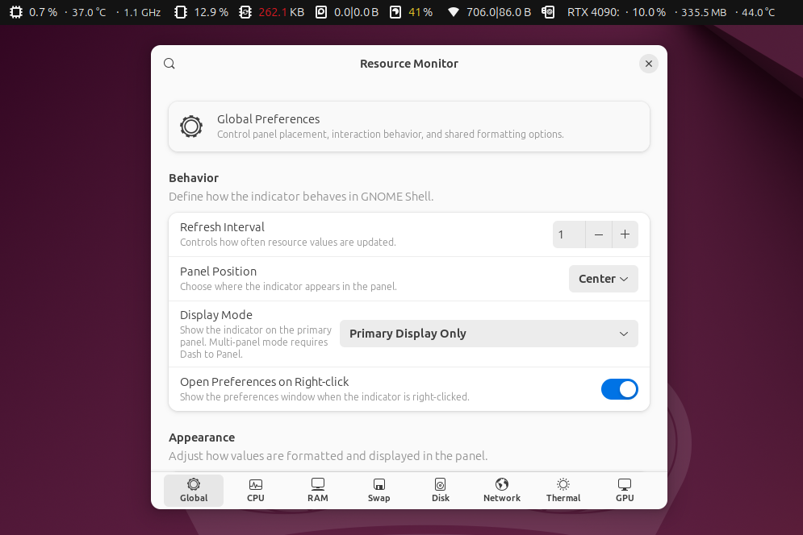

[ego]: https://extensions.gnome.org/extension/1634/resource-monitor/

# Resource Monitor [][ego]

[](LICENSE)
[](https://github.com/sponsors/0ry0n)
[](https://www.paypal.com/paypalme/0ry0n)

Resource Monitor is a GNOME Shell extension that displays system resource usage in the top bar: CPU usage, frequency and temperature; RAM and swap usage; disk activity and space; network traffic; and GPU usage, memory and temperature.

Choose which resources to display and adjust their position, units, colors and number formatting in the extension preferences. Available readings depend on the hardware and drivers. Displaying the indicator on multiple panels requires Dash to Panel.



## Compatibility

This branch supports GNOME Shell 45–51. The supported versions are listed in [metadata.json](Resource_Monitor@Ory0n/metadata.json).

For earlier GNOME Shell versions, see the [3.28–3.38 branch](https://github.com/0ry0n/Resource_Monitor/tree/gnome-3.28-3.38) or the [40–44 branch](https://github.com/0ry0n/Resource_Monitor/tree/gnome-40-44).

## Installation

Install Resource Monitor from [GNOME Extensions](https://extensions.gnome.org/extension/1634/resource-monitor/).

To install a release package manually, download `Resource_Monitor@Ory0n.zip` from [GitHub Releases](https://github.com/0ry0n/Resource_Monitor/releases) and run this command from the download directory:

```bash
gnome-extensions install --force Resource_Monitor@Ory0n.zip
```

Log out and back in, then enable Resource Monitor in the Extensions app. Open its preferences to select the resources to monitor.

## Development

Use `make package` to build the extension ZIP and `make validate` to check it with Shexli. See [Contributing](CONTRIBUTING.md) for dependencies, setup, translations and submission guidance.

## Help and project information

- [Support](SUPPORT.md): troubleshooting and bug reports
- [Changelog](CHANGELOG.md): release history
- [Security](SECURITY.md): private vulnerability reports
- [Code of conduct](CODE_OF_CONDUCT.md): community expectations

## Support development

Contributions are welcome through [GitHub Sponsors](https://github.com/sponsors/0ry0n) or [PayPal](https://www.paypal.com/paypalme/0ry0n).

## License

Resource Monitor is licensed under the GNU General Public License, version 3 or later. See [LICENSE](LICENSE) and [AUTHORS](AUTHORS).

Bundled icons are by GNOME contributors and use the CC0 1.0 Universal dedication. See the [icon attribution](Resource_Monitor@Ory0n/icons/README.md).
